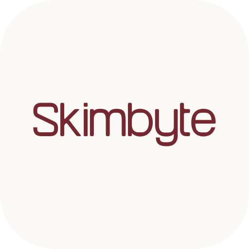

<p align="center">
  <picture>
    <source media="(prefers-color-scheme: dark)" srcset="docs/branding/app-icon-word-dark.svg">
    
  </picture>
</p>

<p align="center">
  <b>A daily, skimmable developer-news brief — one shared Compose codebase on Android, iOS, Desktop, and Web.</b>
</p>

<p align="center">
  <a href="../../actions/workflows/ci.yml"></a>
  
  
  
  <a href="LICENSE"></a>
</p>

---

Skimbyte turns the firehose of developer news (Kotlin, Android, AI, tooling release feeds) into a
once-a-day brief of short, readable summaries. Pick your topics, skim the cards, and bookmark what
you want to keep — the same UI, rendered natively from one Kotlin codebase on every platform.

It is also deliberately a **reference project**: a production-shaped Kotlin Multiplatform +
Compose Multiplatform app with real architecture, real tests (unit + UI + screenshot), adaptive
layouts, and a living design-system catalog — the codebase I wish had existed when I started with
KMP.

## Platforms

| Target | Status | Entry point |
|---|---|---|
| Android | ✅ | `androidApp/` |
| iOS | ✅ | `iosApp/` (Xcode project) |
| Desktop (JVM) | ✅ | `desktopApp/` |
| Web (Kotlin/Wasm) | ✅ | `webApp/` |
| Web (Kotlin/JS) | ✅ | `webApp/` |

## Try it in 60 seconds — no backend needed

```sh
git clone <this repo> && cd Skimbyte
./gradlew :desktopApp:run
```

A fresh clone runs in **demo mode** out of the box: with no API URL configured, Koin swaps in a
mock network module and the whole app works end to end on bundled sample data — feed, topics,
bookmarks, settings, the lot. The same applies to every target (`:androidApp:assembleDebug`,
`:webApp:wasmJsBrowserDevelopmentRun`, the Xcode project in `iosApp/`).

The live backend (posts API + auth server) is closed-source. What changes without it:

| Works offline / in demo mode | Needs the private backend |
|---|---|
| Full UI on all platforms, sample feed & topics | Live daily posts |
| Bookmarks, reading progress, settings | Account sign-in (Google OAuth) |
| `designsheet` component catalog | Avatar/banner upload |
| Entire test suite | — |

To point the app at your own compatible backend, copy `local.properties.example` to
`local.properties` and fill in the endpoints — base URLs are injected into generated code at build
time and are never committed.

## Architecture

- **UI:** 100% [Compose Multiplatform](https://www.jetbrains.com/compose-multiplatform/), Material 3
  Expressive theme, every reusable component previewed light + dark.
- **State:** MVI-flavored ViewModels exposing immutable `StateFlow<UiState>`; composables stay
  stateless, state is hoisted.
- **Navigation:** [Navigation 3](https://developer.android.com/guide/navigation/navigation-3) with
  adaptive scenes — `ListDetailSceneStrategy` and material3-adaptive instead of hardcoded
  breakpoints, so every screen handles foldables and arbitrary window sizes.
- **DI:** Koin across all five targets.
- **Networking:** Ktor client + kotlinx.serialization; Coil 3 for images; a demo/mock network module
  is substituted automatically when no backend is configured.
- **Config:** endpoints live in gitignored `local.properties` and are generated into
  `BackendConfig.kt` at build time — committed source contains no environment URLs.

### Modules

```
shared/       all app code: commonMain + android/ios/jvm/js/wasmJs actuals, all test source sets
androidApp/   Android entry point
iosApp/       Xcode project (iOS entry point)
desktopApp/   Desktop (JVM) entry point
webApp/       Web entry point (JS + Wasm)
designsheet/  runnable component catalog / living style guide (desktop + web)
```

### The designsheet

Every shared design token and reusable component is cataloged in `designsheet/` — a standalone,
navigable app (Navigation 3, adaptive list-detail) that doubles as the project's living style
guide. Run it with `./gradlew :designsheet:run` (desktop) or
`./gradlew :designsheet:wasmJsBrowserDevelopmentRun` (web).

## Testing

Three layers, enforced for every change (see [CONTRIBUTING.md](CONTRIBUTING.md)):

1. **Unit tests** for every piece of logic, in `commonTest`, run per-platform
   (JVM / Android / iOS / JS / Wasm).
2. **Compose UI tests** for every interactive or stateful composable.
3. **[Roborazzi](https://github.com/takahirom/roborazzi) screenshot tests** for shared
   design-system components — goldens are committed under `shared/src/androidHostTest/roborazzi/`
   and verified in CI.

```sh
./gradlew :shared:jvmTest                        # desktop JVM
./gradlew :shared:testAndroidHostTest            # Android host (incl. screenshot tests)
./gradlew :shared:wasmJsTest :shared:jsTest      # web
./gradlew :shared:iosSimulatorArm64Test          # iOS
./gradlew :shared:verifyRoborazziAndroidHostTest # screenshot verify only
./gradlew :shared:recordRoborazziAndroidHostTest # re-record goldens
```

## Build & run

| What | Command |
|---|---|
| Android (debug APK) | `./gradlew :androidApp:assembleDebug` |
| Desktop | `./gradlew :desktopApp:run` |
| Desktop with hot reload | `./gradlew :desktopApp:hotRun --auto` |
| Web (Wasm, modern browsers) | `./gradlew :webApp:wasmJsBrowserDevelopmentRun` |
| Web (JS, older browsers) | `./gradlew :webApp:jsBrowserDevelopmentRun` |
| iOS | open `iosApp/` in Xcode and run |
| Design sheet (desktop) | `./gradlew :designsheet:run` |
| Design sheet (web) | `./gradlew :designsheet:wasmJsBrowserDevelopmentRun` |

Dependency versions are centralized in `gradle/libs.versions.toml` (Kotlin 2.4, Compose
Multiplatform 1.12, Ktor 3, Koin 4, Coil 3).

## Contributing

Issues and PRs are welcome. Read [CONTRIBUTING.md](CONTRIBUTING.md) first — it defines the
architecture rules, Compose conventions, testing requirements, and what belongs in the
designsheet. The short version: stateless composables, previews for everything, tests for
everything, no hardcoded design values.

## License

[Apache License 2.0](LICENSE)