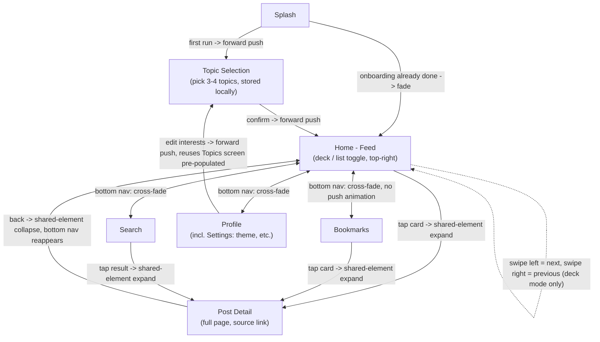

# Navigation architecture: pages and transitions

## Intent and why

Skimbyte already has a working feed, bookmarks, and auth stack, built on
real Navigation 3 infrastructure (`NavDisplay`, `rememberNavBackStack`,
`ListDetailSceneStrategy`) — but it grew organically without a single
target graph: there are three top-level tabs instead of four, search is
an icon bolted onto the feed tab rather than its own destination, "card
detail" exists as two different, incompatible screens, and the nav bar
doesn't adapt to window size. This document defines the target graph
every screen should converge on, and the next section records exactly
where today's implementation already matches it, diverges from it, or
doesn't exist yet — so the plan built from this doc is a migration, not
a rewrite from zero.

The headline interaction is an "Inshorts-style" card deck: one post at a
time, full-bleed, swipeable, with a toggle to fall back to a conventional
list. This is the thing that should feel distinctive; everything else
(search, bookmarks, profile) is conventional by comparison and should not
fight the deck for visual attention.

## Current implementation state (as of 2026-10-18)

Found by inspecting the codebase after the graph below was first drafted.
Recorded here so the plan can cite exact deltas instead of re-describing
things that already exist.

- **Top-level nav**: `App.kt` manually switches on a 3-value
  `TopLevelDestination { Feed, Bookmarks, Account }` enum — no fourth
  Search entry, no `NavigationSuiteScaffold`, no Splash, no onboarding
  gate. `SkimbyteBottomNavBar` is a Material 3 Expressive
  `HorizontalFloatingToolbar`, not a plain bottom bar — it renders
  `TopLevelDestination.entries` plus an optional search icon and FAB
  menu slot, but does not change shape by window size.
- **Feed tab**: `FeedNavHost` already runs real Navigation 3 with
  `ListDetailSceneStrategy` over `FeedHome`/`SearchHome`/`SourceDetail`
  nav keys. `FeedScreen` renders only `StackedCardBrowser` in
  **vertical** orientation (next card below) — there is no list-view
  toggle today, and no tap-to-expand-to-full-page interaction anywhere.
  `PostCard` opens `SourceDetail` only when the *source name text*
  specifically is tapped, not the card body.
- **"Detail" already exists as two different, incompatible screens**:
  `SourceDetail(sourceName)` shows *all posts from that source* (grid or
  horizontal stack — note this horizontal `StackedCardBrowser` mode
  already exists, just not wired to the feed tab), while
  `BookmarkDetail(postId)` in the bookmarks tab shows a *single post* in
  a plain `Scaffold`. Neither is the shared-element, single-post,
  full-bleed Detail this doc describes.
- **Search** is reachable only as an icon inside the Feed tab's own
  nav bar/backstack (`SearchHome` pushed onto `FeedNavHost`'s
  backstack), not a standalone top-level destination with its own
  backstack.
- **Account tab** (`AccountScreen`) is pure auth (login prompt /
  logged-in state + logout) — no settings content, no theme switcher.
- **Theme**: `SkimbyteTheme(darkTheme: Boolean = true)` is hardcoded
  with an in-code comment stating the shipped app is always dark per
  product spec; the `darkTheme` param exists only so `@Preview`s can
  render light mode. There is no persisted theme-mode concept.
- **Topics**: `Topic` is a fixed enum (`All, Kotlin, Android, Kmp,
  Tooling`) used as a single in-memory filter on `FeedViewModel`
  (`selectedTopic`) — no multi-select, no persistence, no onboarding
  flow.
- **Splash**: does not exist in any form.
- Koin DI (`feedModule`, `bookmarksModule`, `postsModule`, `authModule`)
  and the `BookmarkIdsStore`-style local-storage pattern are already
  established and should be followed for any new store.

## Goals

- A single navigation graph, expressed in Navigation 3, that covers every
  screen from first launch onward.
- A card deck as a first-class, equally-supported alternative to a list
  view for browsing the feed, toggled from the top-right of Home.
- A card-to-full-page transition that uses a shared element so the
  article's visual identity (image/title) carries through, both from the
  deck and from the list.
- Every surface that shows a post (deck card, list row, full page) links
  out to the original source.
- Topic selection that gates first launch, persists locally, and is
  editable later from Profile — not a one-time server call.
- Full support for foldables and arbitrary window sizes per the project's
  existing adaptive mandate, using `material3-adaptive` and Navigation
  3's `ListDetailSceneStrategy` rather than hardcoded breakpoints.

## Non-goals

- Visual design of the screens themselves (colors, spacing, exact token
  usage) — that belongs to component-level work against the design
  system, not this document.
- The topic taxonomy (what topics exist, how they map to feed content) —
  that's a content/backend concern.
- Push notifications, offline caching strategy, or feed ranking — out of
  scope for a navigation graph.
- Search's query/ranking behavior — this document only fixes that Search
  is a top-level destination that can expand into the same Detail page;
  how it searches is a separate concern.

## Anti-goals

- A drawer *and* a bottom nav competing as two "primary" navigation
  surfaces. (Originally proposed, dropped during discussion — Settings
  folds into Profile instead.)
- Hardcoded width breakpoints anywhere in the nav or layout decision
  logic — this project already forbids that; this graph must route
  through `material3-adaptive` for every screen.
- Treating the card deck as a secondary/fallback mode. It must be a
  fully equal, independently reachable view of the same feed data as the
  list, not a gimmick bolted on top.
- Swipe gestures on the deck doing anything other than move
  forward/backward through the deck. Bookmarking and other actions are
  explicit buttons, never inferred from swipe direction.

## Constraints

- Navigation is Navigation 3 (`androidx.navigation3`), per CLAUDE.md —
  not Navigation Compose.
- Every screen must support foldables and arbitrary window sizes via
  `material3-adaptive` + `ListDetailSceneStrategy`.
- No nested scrollables in the same orientation (project-wide rule) —
  relevant because the deck, list, and detail page must each own their
  own scrolling independently.
- DI via Koin only.
- Any new/changed shared component must land in `designsheet` in the
  same change that introduces it.
- Dependencies only from `gradle/libs.versions.toml`.

## Decisions made during discussion

**Swipe semantics.** Swipe left = next card, swipe right = previous
card. Purely positional navigation through the deck — no destructive or
save action is bound to a swipe direction. `StackedCardBrowser` already
supports a horizontal paging orientation (currently used for
`SourceDetail`/search results) — the feed tab should switch to that
existing orientation instead of its current vertical one, rather than
building new paging behavior.

**Detail unification.** `SourceDetail` (today's by-source grouped
browse screen) is retired. Tapping a card — anywhere on the card body,
not just the source name — opens a single new `PostDetail(postId)`
destination with the shared-element transition, replacing both
`SourceDetail` and the feed tab's current source-name-only tap target.
`BookmarkDetail(postId)` in the bookmarks tab is replaced by the same
`PostDetail` so there is exactly one detail screen, not two. The
external "view source" link (opening the article's real URL) stays as
an action inside `PostDetail`, unrelated to the retired by-source
browse feature.

**Nav structure.** Four top-level destinations: Home, Bookmarks, Search,
Profile. No drawer. Settings lives inside Profile as a sub-screen, not as
a separate nav surface.

**Nav component.** Keep the existing `SkimbyteBottomNavBar`
(`HorizontalFloatingToolbar`) as-is for compact width — it's already
the project's Material 3 Expressive look and shouldn't be replaced with
a generic `NavigationSuiteScaffold` bottom bar. Add a `NavigationRail`
for medium/expanded width, selected via `currentWindowAdaptiveInfo()`'s
window size class (not a hardcoded dp breakpoint) rather than adopting
`NavigationSuiteScaffold` wholesale — that component doesn't have a
floating-toolbar-shaped compact slot, so using it would mean losing the
existing expressive look. This is a custom two-way switch, not a
single adaptive component, and is the one piece of this graph that
doesn't come from an off-the-shelf M3 adaptive API.

**Detail page chrome.** Expanding a card (from Home, Bookmarks, or
Search) hides the bottom nav entirely — full-screen, immersive reading.
Back collapses the shared element and returns to the exact deck position
or list scroll offset it came from, with the bottom nav reappearing.

**Topic selection persistence and reuse.** Topics are stored locally
(not just submitted to a server), so Home can render on launch without
waiting on a network round trip. The same Topic Selection screen is
reused for editing: first launch gates on a "has completed onboarding"
local flag; returning users skip straight to Home. Editing from Profile
pushes the identical screen pre-populated with the current local
selection.

**Settings scope.** Settings (inside Profile) includes, at minimum, a
theme switcher (light/dark/system). This explicitly overrides the
existing in-code "always dark per product spec" decision in
`SkimbyteTheme` — `darkTheme` becomes a real, persisted user choice
(default system, same local-storage pattern as topics) instead of a
hardcoded `true` with a preview-only escape hatch. Other settings
content is left to the builder.

**Search is a full destination.** Not a top-bar overlay or modal —
it's one of the four nav destinations, with its own results list that
expands into the same Detail page via the same shared-element
transition as Home and Bookmarks. Today `SearchHome` is pushed onto the
Feed tab's own backstack and reached via an icon in Feed's nav bar;
this is promoted to a true top-level destination with its own
independent backstack, reached via the nav bar/rail like Home,
Bookmarks, and Profile.

**Adaptive list-detail behavior.** Home↔Detail (and Bookmarks↔Detail,
Search↔Detail) is the canonical `ListDetailSceneStrategy` pair. On
expanded/unfolded layouts, the feed and the detail content render as two
panes side by side with no push transition. The shared-element
expand/collapse animation is for compact width only, where it's a real
full-screen transition.

**Backstack structure (per top-level destination).** Home, Bookmarks,
Search, and Profile each own an independent backstack — switching
between them via `NavigationSuiteScaffold` preserves whatever state each
tab was in, rather than resetting it. Home, Bookmarks, and Search each
run their own `ListDetailSceneStrategy` scene over their own backstack
(so three independent list↔detail pairings, not one shared one);
Profile's backstack is a simple single-destination stack (plus the
pushed Topics screen when editing interests). This is the standard
Navigation 3 pattern for combining bottom/rail navigation with
per-destination list-detail panes, and it resolves two things a wrong
guess would otherwise cost rework on:
  - **Detail is one shared, parameterized destination** (keyed by post
    id), pushed onto whichever tab's backstack is currently active —
    not three separate destinations that happen to reuse the same
    transition code. This is what "one shared transition spec" means in
    practice.
  - **Deck/list position survives the push to Detail for free**: Home's
    `NavEntry` (and its scoped ViewModel holding deck index / scroll
    offset) stays in the backstack, just not topmost, while Detail is
    pushed on top. Popping Detail off simply re-reveals Home's entry
    with its state untouched — no extra state-hoisting mechanism is
    needed beyond normal Navigation-3-scoped ViewModels.

## Page and transition graph

Notes on the graph:

- Every arrow into `Detail` uses the same shared-element transition
  mechanism regardless of origin (Home, Bookmarks, or Search) — one
  shared transition spec, not three.
- The `Home -.-> Home` self-loop is the deck's internal swipe navigation;
  it never touches the Navigation 3 backstack (it's local state within
  the Home screen, not a navigation event).
- On expanded/unfolded window sizes, the `Home -> Detail` and
  `Bookmarks -> Detail` / `Search -> Detail` edges are realized as
  `ListDetailSceneStrategy` panes rather than a push+shared-element
  transition. The graph's nodes and backstack semantics stay the same;
  only the rendering strategy changes with window size class.

## What's left to the builder

- Exact ViewModel/UseCase boundaries for each screen.
- The local storage mechanism for topic selection and onboarding state
  (e.g. DataStore vs. a dedicated settings store) — pick something
  already used elsewhere in the codebase if precedent exists, otherwise
  default to whatever the project's existing local-storage pattern is
  (see `BookmarkIdsStore` for precedent).
- Exact shared-element transition API usage in Compose Multiplatform/
  Navigation 3 (bounds transform, `SharedTransitionLayout` scope
  placement).
- Full settings screen content beyond the theme switcher.
- Search screen's empty/loading/error states and query debouncing.
- Whether topic edits from Profile require explicit save/cancel or apply
  live — left as an implementation call.
- Preview/test coverage per CONTRIBUTING.md conventions for each new
  screen and shared component introduced.